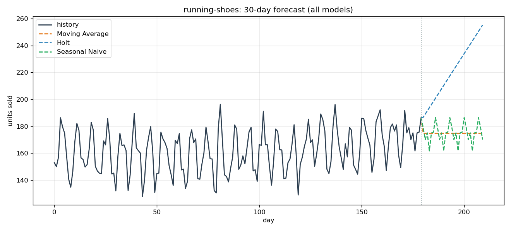
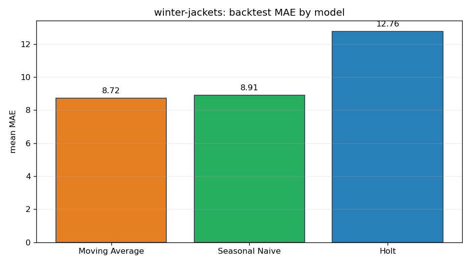

# ForecastKit — demand forecasting toolkit

[](https://www.python.org/)
[](LICENSE)
[](#quickstart)
[](#tech-stack)

ForecastKit is a from-scratch demand-forecasting toolkit for retail sales data. It generates realistic synthetic datasets (trend + weekly/yearly seasonality + noise), fits classical models **implemented by hand — no statsmodels, no sklearn**, and validates them with rolling-origin backtesting (MAE/MAPE) so you can pick the best model for each product with evidence, not vibes.

Everything runs **offline with zero API keys**. If you can `pip install` two packages, you can run the whole pipeline.

---

## Screenshots

**30-day forecast overlay** — history plus all three models, `running-shoes`:



**Backtest MAE comparison** — which model actually won on `winter-jackets`:



*(Charts generated by `python -m forecastkit.cli demo` — see [Quickstart](#quickstart).)*

---

## Features

- **Seeded synthetic data generator** — daily sales for multiple products built from interpretable components: base demand, linear trend, weekly (period 7) and yearly (period 365) seasonality, Gaussian noise. Same seed → same numbers, forever. Ships a bundled `data/demo_sales.csv` (730 days × 3 products).
- **Three from-scratch models** with a clean shared `fit(y)` / `predict(horizon)` interface:
  - *Moving average* — mean of the last `window` observations.
  - *Holt's linear trend method* — level + trend double exponential smoothing, hand-implemented recurrence.
  - *Seasonal naive* — repeats the last observed season.
- **Rolling-origin backtesting** — expanding-window evaluation over N origins, scored with **MAE** and **MAPE**, printed as a comparison table with automatic best-model selection (lowest mean MAE).
- **Forecast charts** — matplotlib PNGs: recent history + per-model forecast overlay, and backtest error bars. All saved to `docs/`.
- **Real CLI** — `backtest`, `forecast`, `demo` subcommands.
- **Real test suite** — 15 pytest tests covering model behavior, metric bounds, and backtest edge cases.

## Tech stack

| Piece | Detail |
|---|---|
| Language | Python 3.10+ (pure Python + numpy) |
| Models | Moving average, Holt exponential smoothing (level+trend), seasonal naive — all implemented from scratch |
| Evaluation | Rolling-origin backtesting, MAE, MAPE |
| Charts | matplotlib (Agg backend, headless-safe) |
| Data | Seeded numpy generator → `data/demo_sales.csv` |
| Tests | pytest |
| Constraints | 100% offline, no API keys, no network calls |

## Quickstart

```bash
git clone https://github.com/872000/forecastkit.git
cd forecastkit
pip install -r requirements.txt

# End-to-end: backtest every product and save charts to docs/
python -m forecastkit.cli demo

# Backtest one product
python -m forecastkit.cli backtest --product running-shoes

# Forecast 30 days ahead and save the chart
python -m forecastkit.cli forecast --product winter-jackets --horizon 30

# Run the test suite
python -m pytest -q
```

Example backtest output:

```
Backtest: running-shoes (horizon=30, splits=4)
model                  MAE    MAPE %  splits
--------------------------------------------
seasonal_naive       10.53      6.23       4
moving_average       13.76      8.15       4
holt                 60.98     36.52       4

Best model: seasonal_naive
```

Products available: `running-shoes`, `coffee-mugs`, `winter-jackets`.

## Project structure

```
forecastkit/
├── forecastkit/            # the package
│   ├── __init__.py
│   ├── data.py             # seeded synthetic sales generator + CSV loader
│   ├── models.py           # MovingAverage, Holt, SeasonalNaive (from scratch)
│   ├── backtest.py         # rolling-origin evaluation, MAE/MAPE, pick-best
│   ├── plotting.py         # matplotlib chart helpers
│   └── cli.py              # backtest / forecast / demo subcommands
├── tests/
│   └── test_forecastkit.py # 15 pytest tests
├── data/
│   └── demo_sales.csv      # bundled demo dataset (730 days x 3 products)
├── docs/
│   ├── banner.png
│   ├── forecast_<product>.png   # history + all-model overlay
│   └── backtest_<product>.png   # MAE comparison bars
├── requirements.txt
├── LICENSE
└── README.md
```

## Roadmap

- [ ] Holt-Winters (additive) with grid-searched smoothing parameters
- [ ] Prediction intervals (bootstrap residuals)
- [ ] CSV import for the user's own sales data (`--csv` flag)
- [ ] Promotion/holiday regressors in the data generator
- [ ] Per-product auto-tuning: pick model *and* hyperparameters per series
- [ ] Streamlit dashboard for interactive exploration

## License

MIT — see [LICENSE](LICENSE).
